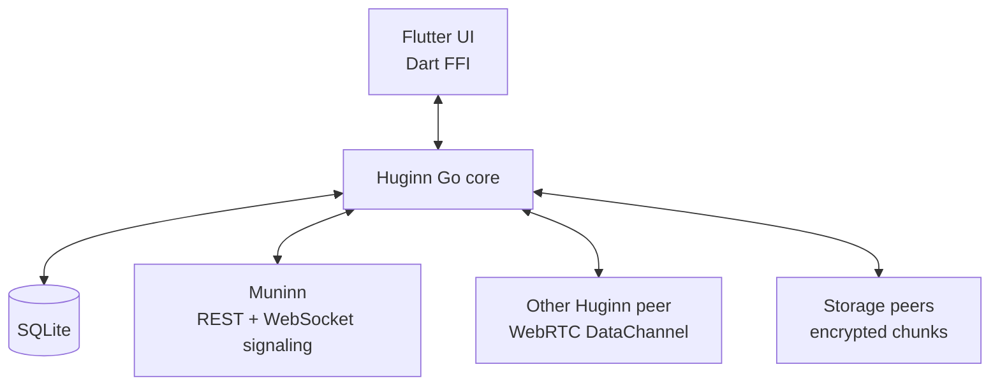

# Huginn Messenger — Go core

Go-ядро P2P-мессенджера Huginn. Проект собирается как shared library для
Flutter-клиента из родительского репозитория. `main.go` также позволяет
запустить ядро без UI для разработки и диагностики.

Muninn используется как directory/signaling service и реестр метаданных
офлайн-чанков. Текст и файлы передаются между Huginn-пирами по WebRTC и не
хранятся в Muninn.

## Возможности

- E2E-шифрование: X25519, AES-256-GCM и Ed25519;
- прямые P2P-соединения через WebRTC DataChannel;
- WebSocket-сигналинг через Muninn с optional HTTP polling fallback;
- резервная и офлайн-доставка зашифрованными чанками через storage-пиры;
- личные и групповые чаты;
- передача файлов и фоновое восстановление вложений;
- локальное SQLite-хранилище;
- relogin с переносом идентичности, истории, контактов и групп;
- C ABI для Flutter/Dart FFI.

## Архитектура



Подробные последовательности и фоновые процессы описаны в
[`docs/architecture.md`](docs/architecture.md). Архитектура Flutter-оболочки
описана в [`../../docs/flutter-application.md`](../../docs/flutter-application.md).

## Требования

- Go 1.25 или новее;
- запущенный Muninn;
- доступные UDP/TCP-маршруты для WebRTC либо настроенный TURN.

## Запуск headless-ядра

Сначала запустите Muninn из соседнего репозитория:

```bash
cd /path/to/muninn
go run .
```

Затем соберите и запустите Huginn:

```bash
cd /path/to/huginn-messenger
go build -o huginn-messenger .

./huginn-messenger \
  --username alice \
  --muninn http://localhost:8080 \
  --db alice.db
```

Процесс регистрирует пира в Muninn и работает без пользовательского
интерфейса. При пустом username создаётся временное UUID-имя.

### Флаги

| Флаг | Значение по умолчанию | Назначение |
|---|---|---|
| `--username` | UUID при пустом значении | Login пользователя |
| `--muninn-servers` | `MUNINN_SERVERS` / config | Известные Muninn для mesh discovery, через запятую |
| `--muninn` | `MUNINN_ADDR`, затем `config.conf` / SQLite | Адрес Muninn, без встроенного сервера |
| `--db` | `huginn.db` | Путь к SQLite |
| `--chunk-ttl` | `1w` | TTL чанков: `1d`, `1w` или `1m` |
| `--peer-flag` | `thin` | Класс storage-пира: `thin`, `thick`, `very_thick` |

Конфигурация также читается из `config.conf`. TURN-поля называются
`turn_addr`, `turn_user` и `turn_pass`.

## Несколько Muninn

Клиент выбирает один активный Muninn из основного адреса и известных
`muninn_servers`. Все рабочие HTTP-запросы, регистрация и WebSocket-сигналинг
идут только через этот сервер. Если он включает mesh, поиск, сигналинг и
офлайн-метаданные охватывают пользователей других участников сети. Обновление C ABI или Flutter UI для самого обмена не требуется;
старые клиенты работают через серверные seeds.

Чтобы задать кандидатов для выбора и познакомить серверы при регистрации,
передайте известные адреса:

```bash
./huginn-messenger --username alice --muninn https://muninn-a.example.org \
  --muninn-servers https://muninn-b.example.org,https://muninn-c.example.org
```

Также поддерживаются `MUNINN_SERVERS` и массив `muninn_servers` в `config.conf`
или сохранённом конфиге. Ядро отправляет их в `POST /api/v1/peers`, хранит в SQLite
и при смене основного сервера добавляет предыдущий адрес. Go-интеграции могут
использовать `messenger.WithMuninnServers([]string{...})` или поле
`muninn.RegisterRequest.MuninnServers`. Клиент передаёт не более 16 уникальных
адресов, исключая свой текущий сервер. Mesh-секрет клиенту не нужен: режим и
членство проверяются серверами.

Выбор выполняется перед запуском соединений и затем при разрыве WebSocket с
активным сервером. Пока WebSocket подключён, периодических проверок кандидатов
нет; ошибки HTTP сами по себе не запускают смену сервера. Только
служебные `GET /health` идут к другим кандидатам: по два замера успешного ответа
`{"status":"ok"}`, с таймаутом 1 секунда на замер. Между проверками время ответа
сглаживается: 70% предыдущей оценки + 30% нового измерения. Выбирается наименьшая
задержка среди исправных серверов. При одном адресе дополнительных проб нет.

После разрыва клиент заново сравнивает кандидатов без минимального времени
удержания сервера и порога улучшения задержки. Прежний сервер может остаться
выбранным, если он исправен и всё ещё самый быстрый. Если WebSocket не удаётся
подключить, кандидат исключается из выбора на минуту, даже когда `/health`
отвечает успешно. Успешное переподключение снимает это ограничение. Пока связи
нет, попытки выбора и подключения повторяются с паузой 5 секунд; частые разрывы
также не запускают проверки чаще раза в 5 секунд. Если альтернатив нет, клиент
продолжает подключаться к прежнему серверу. Отмена запроса пользователем не
считается сбоем сервера.

При переключении ядро дожидается завершения рабочих запросов, закрывает прежний
WebSocket, регистрирует свой endpoint и группы на выбранном Muninn, затем
переподключает сигналинг. Неудачная регистрация оставляет прежний выбор и
исключает кандидата из выбора на минуту. Рабочий запрос, завершившийся ошибкой,
не повторяется автоматически на другом сервере; повторы выполняют существующие
очереди доставки. HTTP redirect не может незаметно перенаправить запрос к другому
серверу.

Прежняя регистрация не удаляется автоматически и истекает по TTL. Обновлённый
Muninn при одинаковом endpoint ID выбирает сервер с активным WebSocket и при
подключении собирает ожидающие сигналы из mesh. Для такого переноса без удаления
старых записей обновите Muninn участников сети. Все кандидаты должны принадлежать
одной сети, чтобы история metadata оставалась доступной после смены сервера.

Выбранный адрес сохраняется в SQLite и возвращается через `messenger_get_config`;
остальные адреса сохраняются как кандидаты. `messenger_save_config` принимает
необязательный массив `muninn_servers`; C ABI не изменён. Для прямого использования
Go HTTP-клиента доступны `Client.SetServers`, `Client.SelectFastest`,
`Client.SelectAfterDisconnect` и связанный `NewSelectedWSClient`; в `Messenger`
проверка при разрыве и повторное подключение включены автоматически.

## Как доставляются сообщения

### Сигналинг

Клиент подключается к `ws://<muninn>/api/v1/ws?peer_id=<id>` либо к `wss://`
для HTTPS. Через JSON-RPC-подобные сообщения `connect_to_peer` и
`signal_relay` передаются SDP offer/answer. При `messenger.WithPoll()` доступен
HTTP fallback через:

- `POST /api/v1/peers/{id}/signals`;
- `GET /api/v1/peers/{id}/signals` с polling каждые 500 мс.

Обычный headless/FFI startup не включает `WithPoll`: если WebSocket временно
недоступен, исходящий сигнал можно поставить через HTTP, но target получит его
после восстановления WebSocket-соединения.

После согласования соединения Muninn больше не участвует в передаче payload.

### Онлайн-доставка

До успешного ответа на отправку ядро проверяет получателя и файлы, шифрует
payload и одной транзакцией сохраняет сообщение и очередь всех его чанков в
SQLite. Ошибки подготовки возвращаются вызывающей стороне. Успех означает
приём в локальную очередь, а не подтверждение доставки получателю.

Доставка выполняется в фоне. Для текста ядро до пяти секунд ожидает открытый
WebRTC DataChannel; офлайн-представление уже сохранено как резервный путь.

### Офлайн-доставка и файлы

Payload разбивается на части по 1024 байта. Каждая часть шифруется и
подписывается, сохраняется локально, регистрируется в Muninn и по возможности
реплицируется на quality-ranked storage-пиры. Получатель запрашивает метаданные:

```text
GET /api/v1/recipient/chunks?recipient_id=<key>&date_from=<unix>
```

Данные чанков забираются непосредственно у Huginn-пиров по WebRTC. После
проверки хэшей и подписей сообщение восстанавливается и сохраняется в SQLite.

Очередь текста и вложений переживает перезапуск и повторяет регистрацию в
Muninn, даже если других storage-пиров нет. Копия считается размещённой только
после `chunk_store_ack`, подтверждающего запись на storage-пире. Старые ядра
принимают чанки, но не присылают ACK: отправитель продолжает повторы до TTL.
Исходные чанки сохраняются до TTL, включая уже подтверждённые копии.

Неудачное получение или расшифровка сохраняется в SQLite для повтора независимо
от курсора опроса. Миграция 011 сбрасывает старые отметки размещения и курсор,
чтобы повторно проверить доступные манифесты; история защищена от дублей по ID.

## Flutter UI и real-time события

Flutter-клиент вызывает функции из
`bridge.go` через Dart FFI и получает события `peers`, `message` и `file_ready`
через `messenger_get_event`.

## Структура проекта

```text
main.go                         headless entry point
bridge.go                       exported C ABI and Flutter event queue
internal/config/                CLI and persisted configuration
internal/crypto/                encryption, key exchange and signatures
internal/chunk/                 1 KiB chunk envelopes and reassembly
internal/webrtc/                P2P WebRTC manager and DataChannel protocol
internal/muninn/                Muninn REST and WebSocket clients
internal/messenger/             delivery, groups, files and relogin
internal/store/                 SQLite store and migrations
docs/architecture.md            detailed protocol diagrams
```

## Shared library для Flutter

```bash
make library
```

Результат находится в `dist/linux_<arch>/`. `make package-library` дополнительно
создаёт версионированный архив с `.so`, C-заголовком и `SHA256SUMS`.

Контрактом служат экспортированные функции в `bridge.go`. При его изменении
нужно синхронно обновить C-заголовок и Dart FFI-обёртку родительского
Flutter-проекта.

## Тесты

```bash
GOCACHE=/tmp/huginmunin-messenger-go-cache go test ./...
```

Интеграционные тесты используют локальные HTTP/WebSocket listeners, поэтому
среда запуска должна разрешать loopback-соединения.

### Адрес Muninn через C ABI

`messenger_create` и `messenger_create_with_peer_flag` используют явно переданный
адрес с приоритетом над SQLite. Пустой адрес загружает сохранённый `muninn`
до создания HTTP и WebSocket клиентов. Если адрес отсутствует, возвращается
`-4`; подключения к серверу по умолчанию нет. Flutter в этом случае повторяет
создание с адресом из `assets/config.json`. Бот всегда передаёт `MUNINN_ADDR`.
Сигнатуры C ABI не изменены, но потребителям нужна новая сборка библиотеки.
